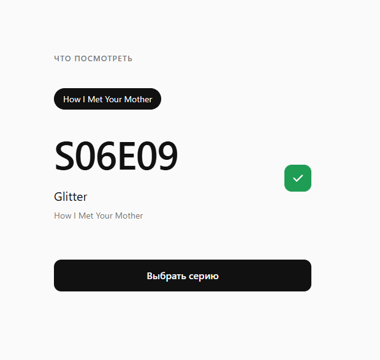

[English](README.md) | **Русский**

# Series Randomizer

🎲 Пикер случайной серии выбранного сериала. Ведётся трекинг уже просмотренных серий, новая серия выбирается из числа оставшихся непросмотренных. Сериалы, добавленные на текущий момент:
- «Как я встретил вашу маму» (2005)



## 🚀 Standalone

```bash
docker compose up -d --build
```

→ <http://localhost:8080>

## ⚙️ Настройка

Необязательно: без `.env` используются значения по умолчанию. Чтобы их изменить, скопируйте `.env.example` в `.env`.

| Переменная | По умолчанию | Назначение |
|---|---|---|
| `POSTGRES_DB` | `series` | имя базы |
| `POSTGRES_USER` | `series` | пользователь базы |
| `POSTGRES_PASSWORD` | `series` | пароль базы, применяется только при первом создании базы |
| `APP_PORT` | `8080` | порт приложения на `127.0.0.1` |
| `PROXY_NETWORK` | `series-proxy` | Docker-сеть для reverse proxy |
| `PROXY_EXTERNAL` | `false` | `true`, если сеть `PROXY_NETWORK` уже существует и не управляется этим проектом |

## 🔀 Reverse proxy

Укажите в `.env` существующую Docker-сеть прокси. Внутри неё приложение доступно по адресу `http://series-randomizer:8080`.

```bash
cp .env.example .env
```

```env
PROXY_NETWORK=traefik
PROXY_EXTERNAL=true
```

```bash
docker compose up -d --build
```

## 📺 Данные

Данные о сериях: [TVmaze](https://www.tvmaze.com/), [CC BY-SA 4.0](https://creativecommons.org/licenses/by-sa/4.0/).
